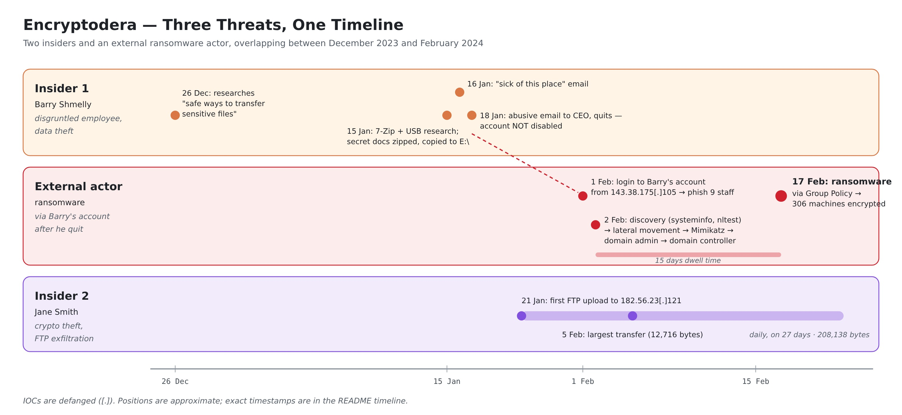
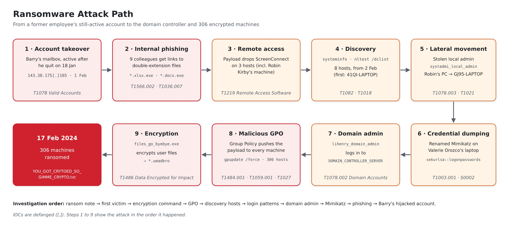

# SOC Investigation - Insider Threats and Domain-Wide Ransomware (KC7 "Encryptodera")

## Description

Multi-threat SOC investigation at a fictional fintech company, Encryptodera Financial, completed on the [KC7 Cyber](https://kc7cyber.com) platform. Using **KQL** across ten log sources (email, authentication, process, file, web, network flow and DNS), I uncovered three overlapping incidents:

1. A **disgruntled employee** stealing confidential documents onto a USB drive before quitting.
2. An **external actor** who took over that employee's still-active account, phished colleagues, moved laterally, dumped domain-admin credentials and used **Group Policy to ransom 306 machines**.
3. A **second insider** quietly exfiltrating data over FTP to an accomplice planning to steal the company's crypto.

> **Platform:** KC7 Cyber, module *Inside Encryptodera: An Insider Threat Scenario* (Advanced) · 
> **Tools:** Azure Data Explorer (Kusto) · KQL · MITRE ATT&CK

---

## Executive Summary (Incident Report)

| | Insider 1: data theft | External actor: ransomware | Insider 2: crypto theft |
|---|---|---|---|
| **Who** | Barry Shmelly, employee (left 18 Jan) | Unknown actor via `143.38.175[.]105` | Jane Smith, Blockchain Contractor |
| **What** | Copied M&A strategy, executive salaries and proprietary algorithms into a password-protected archive and onto a USB drive | Hijacked Barry's account, phished 9 staff, reached the domain controller, deployed ransomware by GPO | Scheduled daily FTP uploads to an accomplice; researched cold-storage crypto wallets |
| **When** | 26 Dec 2023 to 18 Jan 2024 | 1 to 17 Feb 2024 (**15 days** of dwell time before encryption) | From 21 Jan 2024, on 27 days |
| **Impact** | Confidential business data in a former employee's hands (possible insider trading) | **306 machines encrypted** (`*.umadbro`), domain admin compromised | 208,138 bytes exfiltrated to `182.56.23[.]121`; planned crypto theft |
| **Root cause** | No data-loss controls on sensitive files or USB | **Leaver account not disabled**; phishing; local admin password reuse | No outbound FTP control or insider monitoring |

**Priority actions:** disable all leaver accounts; reset domain-admin and local-admin credentials (krbtgt twice); remove the malicious GPO; isolate and rebuild affected hosts; block the attacker IP, C2 domain and FTP destination; suspend Jane's access and preserve evidence for HR and legal; brief legal on Barry's data theft.

---

## Data Sources

| Table | Used for |
|---|---|
| `Employees` | Mapping IPs, hosts and usernames to people and roles |
| `Email` | Hostile messages, phishing links, accomplice communication |
| `AuthenticationEvents` | Account takeover, lateral movement, domain-admin use |
| `ProcessEvents` | Command lines: encryption, discovery, Mimikatz, archiving, exfil tool |
| `FileCreationEvents` | Ransom notes, encrypted files, payloads, USB copies |
| `OutboundNetworkEvents` | Browsing history: research, reconnaissance, link clicks |
| `NetworkFlow` | Data volumes, ports and destinations (FTP exfiltration) |
| `PassiveDns`, `InboundNetworkEvents`, `SecurityAlerts` | Available for pivoting and enrichment |



---

## Thread 1: Insider Threat - Barry Shmelly

*Trigger: colleagues reported that Barry, a "StackOverflow Copy Paster", had been behaving strangely and posting angrily about layoffs.*

| Step | Finding | Analyst reasoning |
|---|---|---|
| Emails | 16 Jan: *"I'm not coming in today. I'm sick of this place. We're all getting laid off anyway."* to the Social Media Managers. 18 Jan: *"YOU ARE A GREEDY PIG!!!!"* to the **CEO** | Changed behaviour and grievance are classic insider-risk indicators. They justify looking at his technical activity. |
| Research | 26 Dec: browsed *cybersecurity-insiders.com/safe-ways-to-transfer-sensitive-files*. 15 Jan: downloaded **7-Zip**, read how to use a **USB flash drive** | Shows **intent** and planning weeks before acting |
| Collection | Downloaded `SECRET_MergersAndAcquisitions_Strategy2025.docx`, `ExecutiveSalaryNegotiations.docx`, `Encryptodera_Proprietary_Algorithms.zip` | Material for insider trading, grievance and competitive harm |
| Staging | Zipped the files with the password `securepass123` | Password protection defeats content inspection by DLP tools |
| Exfiltration | Copied the final files to removable drive `E:\SchmellyDrive\` | Removable media bypasses every network control |

```kql
let barry_host = toscalar(Employees | where name == "Barry Shmelly" | project hostname);
FileCreationEvents
| where hostname == barry_host
| where path startswith @"E:\"
| project timestamp, filename, path
```

→ All queries: [`01-insider-barry-data-theft.kql`](queries/01-insider-barry-data-theft.kql)

**Assessment:** a deliberate, planned theft of confidential data by a departing employee. It was too late to prevent, but now documented for HR and legal. Barry's account was **not disabled** when he left on 18 Jan, and that became the entry point for Thread 2.

---

## Thread 2: Domain-Wide Ransomware



I worked **backwards from the impact**, the standard approach when you start from a ransom note. Each finding raised the next question.

### 2a: Scope and patient zero

| Question | Finding |
|---|---|
| What happened? | Ransom note `YOU_GOT_CRYTOED_SO_GIMME_CRYPTO.txt` demands payment, so this is **ransomware** |
| How big? | Note found on **306 machines** |
| Where did it start? | First seen **2024-02-17 02:34:54 UTC** on **UL8R-MACHINE** |
| What was encrypted? | 50 files on that host, renamed with the extension **`.umadbro`** |
| By what? | `start /b C:\ProgramData\files_go_byebye.exe -encrypt -target C:\Users\ -ext .umadbro` |
| When did the binary land? | 2024-02-17 02:30:50, four minutes before the note |

**Temporal analysis** of the 23 commands on UL8R-MACHINE between 16 and 18 Feb showed a **base64-encoded PowerShell** command referencing `notification-finance-services[.]com`, run right after **`gpupdate /force`**.

**Analyst reasoning:** `gpupdate /force` on a victim right before the payload means the ransomware arrived through **Group Policy**. That only works with domain-admin rights, so the real question became *how did the attacker get to the domain controller?* The same command ran on **all 306** encrypted hosts, which confirms it.

→ [`02-ransomware-scoping.kql`](queries/02-ransomware-scoping.kql)

### 2b: Finding the intrusion

| Question | Finding |
|---|---|
| When did the attacker arrive? | First `systeminfo` (discovery) on **2024-02-02 03:32:36** on **41QI-LAPTOP**, ran on 8 hosts in total |
| Dwell time | **15 days** between discovery and encryption |
| What were they looking for? | `cmd.exe /C nltest /dclist:encryptoderafinancial.com`: locating the **domain controller** |
| How did they get onto 41QI-LAPTOP? | `Company_Financials_Q1_2024_Review.xlsx.exe`, a **double-extension** file posing as Excel, dropped `screenconnect_client.exe` seconds later |
| Persistence | ScreenConnect (legitimate remote-access software) on **3 hosts** |
| How was the file delivered? | An email link sent from **`barry_shmelly@encryptoderafinancial.com`** |

**The pivot that connected the threads:** Barry quit on 18 Jan, yet his account sent **9 unusual emails** from 1 Feb. Authentication logs show his account signed in on 1 Feb from the external IP **`143.38.175[.]105`**, which never logged into any other account. The attacker was using **a former employee's account that was never disabled** to phish his ex-colleagues. Messages from a known colleague are far more convincing than ones from an outsider.

→ [`03-ransomware-intrusion-path.kql`](queries/03-ransomware-intrusion-path.kql)

### 2c: Lateral movement and domain compromise

The external IP explained initial access but not the spread. To find lateral movement, I looked for a **login source common to all 8 discovery hosts**:

```kql
let hosts = ProcessEvents
| where process_commandline has "systeminfo"
| distinct hostname;
AuthenticationEvents
| where hostname in (hosts)
| summarize hosts_logged_into = dcount(hostname) by src_ip
| order by hosts_logged_into desc
```

| Finding | Significance |
|---|---|
| **2 internal IPs** logged into all 8 hosts; `10.10.0.138` belongs to a **System Administrator** | 554 successful logins from one admin IP, including to **DOMAIN_CONTROLLER_SERVER** |
| The domain controller was accessed with **`lihenry_domain_admin`** | Domain admin compromised |
| That account had also signed into **GJ95-LAPTOP** (Valerie Orozco) | Where the credentials were exposed |
| On GJ95-LAPTOP: `totally_not_mimikatz.exe "sekurlsa::logonpasswords"` | **Credential dumping** with renamed Mimikatz (S0002). Renaming beats name-based detection, but the module name gives it away |
| Valerie *was* phished (`Employee_Contact_List_Updated_March_2024.docx.exe`) but **did not click** | So how did the attacker reach her laptop? |
| Three accounts logged into her laptop; the odd one, **`systadmi_local_admin`**, tried 10 hosts | A shared local admin password, the classic lateral-movement enabler |
| A **non-IT user, Robin Kirby**, was using the local admin account | Robin was phished from Barry's account at **2024-02-01 03:59:30**, so this is Robin's compromised machine |

**Reconstructed path:** Barry's hijacked account → phish → Robin Kirby's PC (ScreenConnect) → `systadmi_local_admin` → Valerie's laptop → Mimikatz → `lihenry_domain_admin` → domain controller → malicious GPO → 306 machines encrypted.

→ [`04-lateral-movement-and-domain-compromise.kql`](queries/04-lateral-movement-and-domain-compromise.kql)

---

## Thread 3: Insider Threat - Jane Smith

*Trigger: during capacity testing, the network admin noticed an unusually large volume of data going to one external IP on 5 Feb.*

This thread starts from **network data alone**, with no alert and no tip-off.

| Step | Finding | Analyst reasoning |
|---|---|---|
| Anomaly | `182.56.23[.]121` received the most data on 5 Feb: **12,716 bytes** | Start with volume, then establish the baseline |
| Baseline | Data sent since **2024-01-21 13:28:33**, on **27 distinct days**, **208,138 bytes** in total, over **FTP** | A long-running, regular transfer over an unencrypted, unusual protocol isn't business traffic |
| Attribution | Exactly **1** sender: **Jane Smith**, *Crypto Bruh (Blockchain Contractor)* | A community-engagement role has no reason to move bulk data out |
| Reconnaissance | Browsed the company site for the location of the **cold storage crypto wallets** | Motive and target |
| Collusion | Emails with **`elboss@westealurcrypto[.]com`**, who supplied the drop IP `182.56.23[.]121` | Confirms intent and an external accomplice |
| Tooling | Downloaded **`ftp_client.exe`** (exfiltration) and **`crypto_stealer.exe`** | Capability to execute the plan |
| Execution | Exfil tool pointed at `C:\Users\jasmith\ToTheMoon\`, scheduled to run **daily**, with a hard-coded password | Staged, automated, recurring exfiltration (T1029 Scheduled Transfer) |

```kql
NetworkFlow
| where dest_ip == "182.56.23.121"
| summarize first_seen = min(timestamp), active_days = dcount(bin(timestamp, 1d)),
            total_bytes = sum(bytes), senders = dcount(src_ip) by dest_port
```

→ [`05-insider-jane-crypto-exfiltration.kql`](queries/05-insider-jane-crypto-exfiltration.kql)

**Assessment:** an active, premeditated insider operation with an external partner, caught before the crypto theft itself appears in the logs. This calls for immediate containment and legal involvement, not just monitoring.

---

## Consolidated Timeline

| Time (UTC) | Thread | Event |
|---|---|---|
| 2023-12-26 | Barry | Researches "safe ways to transfer sensitive files" |
| 2024-01-15 | Barry | Downloads 7-Zip; researches USB flash drives |
| 2024-01-16 | Barry | "Sick of this place" email to the Social Media Managers |
| 2024-01-18 | Barry | Abusive email to the CEO; leaves the company. **Account stays active.** |
| 2024-01-21 13:28 | Jane | First FTP upload to `182.56.23[.]121` |
| 2024-02-01 | Ransomware | Barry's account signs in from `143.38.175[.]105`; 9 phishing emails sent |
| 2024-02-01 03:59 | Ransomware | Robin Kirby phished from Barry's account |
| 2024-02-02 03:32 | Ransomware | First discovery (`systeminfo`) on 41QI-LAPTOP, then `nltest /dclist` |
| Early to mid Feb | Ransomware | Lateral movement with `systadmi_local_admin`; Mimikatz on GJ95-LAPTOP; domain-admin login to the DC |
| 2024-02-05 | Jane | Largest single-day transfer (12,716 bytes) |
| 2024-02-17 02:30 | Ransomware | `files_go_byebye.exe` lands via GPO (`gpupdate /force`) |
| 2024-02-17 02:34 | Ransomware | First ransom note; **306 machines** encrypted |

## Indicators of Compromise

| Type | Indicator | Context |
|---|---|---|
| IPv4 | `143.38.175[.]105` | Attacker sign-in to Barry's account |
| Domain | `notification-finance-services[.]com` | Referenced in encoded PowerShell |
| IPv4 | `182.56.23[.]121` | FTP exfiltration destination (Jane) |
| Email | `elboss@westealurcrypto[.]com` | External accomplice |
| File | `files_go_byebye.exe` | Ransomware encryptor (`C:\ProgramData\`) |
| File | `YOU_GOT_CRYTOED_SO_GIMME_CRYPTO.txt` | Ransom note |
| Extension | `.umadbro` | Encrypted files |
| File | `Company_Financials_Q1_2024_Review.xlsx.exe`, `Employee_Contact_List_Updated_March_2024.docx.exe` | Double-extension phishing payloads |
| File | `screenconnect_client.exe` | Remote-access persistence |
| File | `totally_not_mimikatz.exe` | Renamed Mimikatz |
| File | `ftp_client.exe`, `crypto_stealer.exe` | Insider tooling (Jane) |
| Accounts | `barry_shmelly`, `systadmi_local_admin`, `lihenry_domain_admin` | Compromised or abused; reset required |

*Indicators are defanged (`[.]`) and come from a fictional training scenario.*

## MITRE ATT&CK Mapping

| Tactic | Technique | Evidence |
|---|---|---|
| Initial Access | T1078 Valid Accounts | Barry's account, used after he left |
| Initial Access | T1566.002 Phishing: Spearphishing Link | Links to payloads in emails to 9 staff |
| Defense Evasion | T1036.007 Masquerading: Double File Extension | `.xlsx.exe`, `.docx.exe` |
| Defense Evasion | T1027 Obfuscated Files or Information | Base64-encoded PowerShell |
| Execution | T1059.001 PowerShell | Encoded PowerShell on victims |
| Command and Control | T1219 Remote Access Software | ScreenConnect on 3 hosts |
| Discovery | T1082 System Information Discovery | `systeminfo` on 8 hosts |
| Discovery | T1018 Remote System Discovery | `nltest /dclist` |
| Credential Access | T1003.001 OS Credential Dumping: LSASS Memory | `sekurlsa::logonpasswords` (Mimikatz, S0002) |
| Lateral Movement / Privilege Escalation | T1078.003 Local Accounts · T1078.002 Domain Accounts | `systadmi_local_admin`, `lihenry_domain_admin` |
| Defense Evasion / Privilege Escalation | T1484.001 Group Policy Modification | Payload deployed via GPO, `gpupdate /force` |
| Impact | T1486 Data Encrypted for Impact | 306 hosts, `.umadbro` |
| Collection (insiders) | T1560.001 Archive via Utility · T1074.001 Local Data Staging | 7-Zip with password; `ToTheMoon` folder |
| Exfiltration (insiders) | T1052.001 Over USB · T1048.003 Over Unencrypted Non-C2 Protocol · T1029 Scheduled Transfer | Barry's USB drive; Jane's daily FTP |

## Response Recommendations

**Contain and eradicate (ransomware)**
1. Remove the malicious GPO and `files_go_byebye.exe`. Isolate encrypted hosts and restore from offline backups.
2. Reset `lihenry_domain_admin` and every privileged account. Reset **krbtgt twice**, and assume all credentials on the DC are compromised.
3. Remove ScreenConnect from the 3 hosts. Reset `systadmi_local_admin`, and deploy **LAPS** so every machine has a unique local admin password.
4. Block `143.38.175[.]105` and `notification-finance-services[.]com`. Purge the 9 phishing emails.

**Insiders**
5. Suspend Jane Smith's access, block `182.56.23[.]121` and outbound FTP, and preserve evidence for HR and legal. Check the cold-storage wallets for unauthorised movement.
6. Hand Barry's data-theft evidence to legal (confidential documents, potential insider trading).

**Fix the root causes**
7. **Joiner-mover-leaver process:** disable accounts on the leaving date and alert on any leaver sign-in. This single gap made the whole ransomware attack possible.
8. Separate admin tiers. Domain admins should never log into workstations.
9. DLP and device control for USB storage. Insider-risk monitoring for high-risk events like resignations, layoffs and grievances.
10. Behaviour-based detections, see [`06-detection-rules.kql`](queries/06-detection-rules.kql): leaver sign-ins, double extensions, Mimikatz module names (whatever the binary is called), remote-access tools, discovery bursts, domain admins on workstations, recurring outbound FTP.

## Lessons Learned

- **Threats overlap.** Three unrelated actors were active in the same weeks. Closing the first story too early would have missed the other two.
- **The identity lifecycle is a security control.** A forgotten account belonging to an angry ex-employee became the attacker's way in, and their phishing was believable because it came from a colleague.
- **Work backwards from impact, then forwards from root cause.** I started at the ransom note and pivoted to the first victim, the GPO, discovery, login patterns, the domain admin, Mimikatz, the phish and the account takeover. Each answer narrowed the next query.
- **Renaming a tool doesn't hide its behaviour.** `totally_not_mimikatz.exe` still runs `sekurlsa::logonpasswords`. Detections should key on behaviour and arguments, not file names.
- **Insiders show up in boring data.** Jane triggered no alert. She was found through bytes per destination per day, and a baseline turned "big transfer" into "27 days of regular FTP".
- **Insider risk needs people as well as technology.** Barry's emails and public posts were the earliest signal. Insider-risk programmes need HR and the SOC working together.

## Skills Demonstrated

- KQL across 10 tables: `let` statements, `toscalar`, `join`, `in`, `has_any`, `summarize` with `dcount`/`min`/`sum`, `bin`, `extract`, `base64_decode_tostring`, `matches regex`
- Ransomware investigation: scoping, patient zero, temporal analysis, deployment via GPO
- Intrusion analysis: discovery, lateral movement, credential dumping, domain compromise
- Insider-threat investigation: behavioural indicators, data staging, USB and FTP exfiltration
- Authentication-log analysis to spot account takeover and abuse of shared credentials
- Network-flow baselining and anomaly detection
- Decoding obfuscated commands, timeline reconstruction, IOC extraction
- MITRE ATT&CK mapping, detection engineering and incident reporting with root-cause recommendations

A KQL quick reference for the techniques used is in [`docs/kql-cheatsheet.md`](docs/kql-cheatsheet.md).

---

*Scenario, data and story by [KC7 Cyber](https://kc7cyber.com)*

*Author: Mazen Yousef | [LinkedIn](https://linkedin.com/in/mazenyousef) | [TryHackMe](https://tryhackme.com/p/mazen.yousef)*
